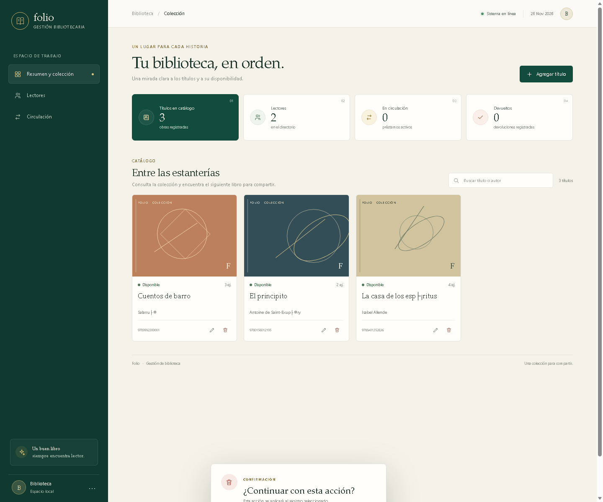
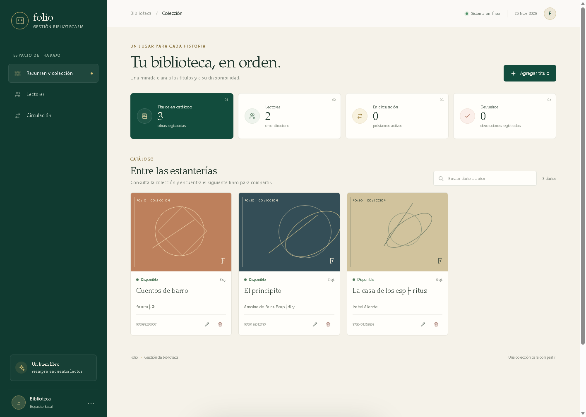
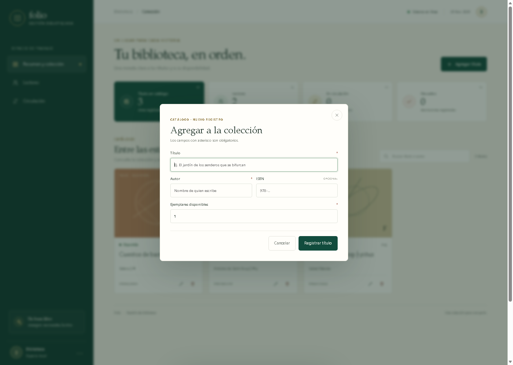
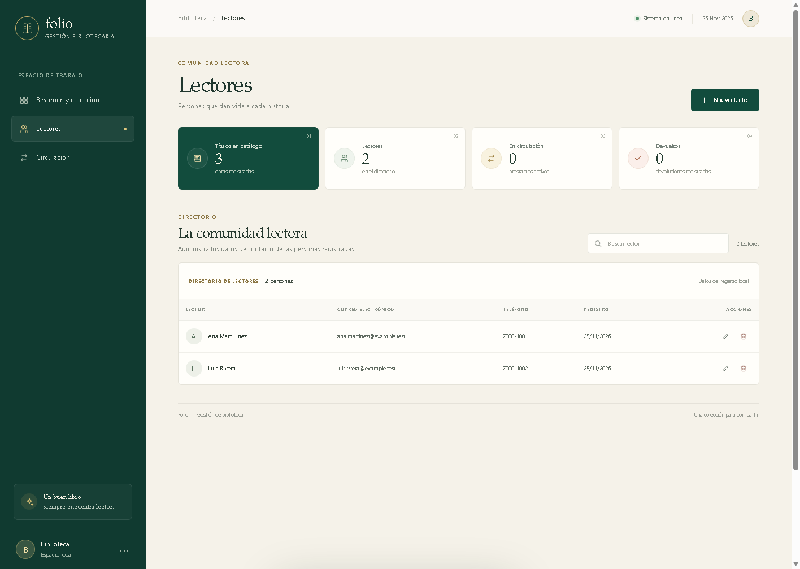
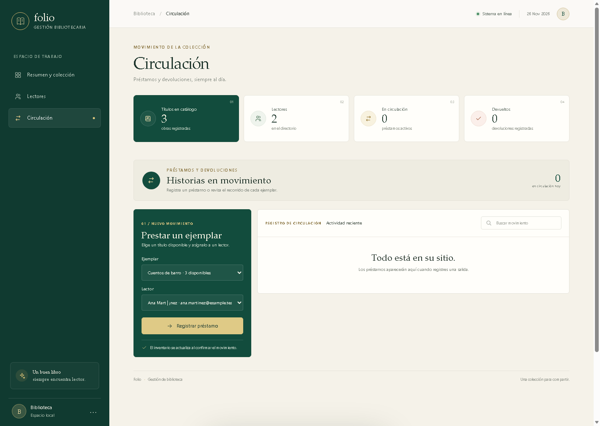
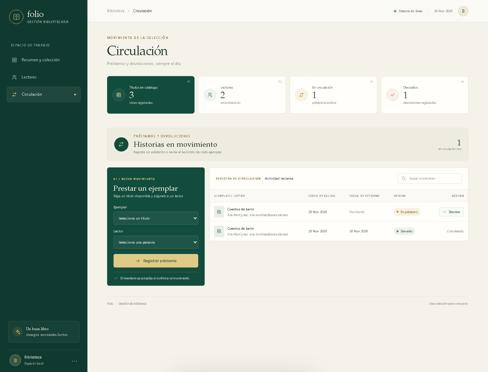

# Sistema de Gestión de Biblioteca

Miniaplicación académica de Kodigo para administrar libros, lectores y préstamos con PHP orientado a objetos, PDO y MySQL/MariaDB.

## Funcionalidades

- Crear, listar, consultar, editar y eliminar libros y usuarios.
- Validar títulos, autores, correo electrónico, identificadores y cantidades.
- Registrar préstamos solo para libros con existencias y usuarios existentes.
- Registrar devoluciones una sola vez y devolver el ejemplar a disponibilidad.
- Consultar el historial completo de préstamos y el estado de circulación.
- Mantener la consistencia de inventario con transacciones y bloqueos de fila.
- Proteger formularios con token CSRF, usar POST para cambios y escapar texto HTML.
- Conservar libros y usuarios cuando existen préstamos asociados; las claves foráneas impiden borrar el historial.

## Tecnologías

PHP 8.2 (XAMPP) o PHP 8.0 o posterior, programación orientada a objetos, PDO, MySQL/MariaDB, HTML5, CSS propio y JavaScript ligero para búsqueda, navegación móvil y modales. No utiliza frameworks.

## Requisitos previos

- Windows con XAMPP 8.x u otra distribución compatible.
- PHP con las extensiones `PDO` y `pdo_mysql` habilitadas.
- MySQL o MariaDB con el motor InnoDB.
- Git para clonar el repositorio.

La actividad se desarrolló y probó con XAMPP 8.2.12 (PHP 8.2.12, MariaDB 10.4.32) y también con PHP CLI 8.4.22. El puerto MySQL puede ser 3306 u otro puerto configurado en tu instalación.

## Instalación

1. Clona el repositorio publicado y entra a la carpeta:

   ```powershell
   git clone https://github.com/YamiLinares/biblioteca.git
   Set-Location biblioteca
   ```

2. Abre XAMPP Control Panel e inicia MySQL. Apache no es necesario para usar el servidor integrado de PHP.

3. En phpMyAdmin (`http://localhost/phpmyadmin`), importa `biblioteca.sql`. El script crea la base exclusiva `biblioteca_kodigo`, las tablas y algunos registros ficticios. No contiene comandos para borrar bases o tablas. Si tu servidor usa un puerto distinto al configurado en phpMyAdmin, utiliza el cliente MySQL de esa instancia o ajusta la conexión de phpMyAdmin a ese puerto.

4. Copia el archivo de ejemplo para crear la configuración local. En PowerShell:

   ```powershell
   Copy-Item config.example.php config.local.php
   ```

   Edita `config.local.php` con el host, puerto, base de datos, usuario y contraseña de tu MySQL. Este archivo está excluido de Git. No publiques credenciales.

5. Inicia el servidor local desde la carpeta del proyecto. Con XAMPP:

   ```powershell
   C:\xampp\php\php.exe -S 127.0.0.1:8085 router.php
   ```

   Si el puerto 8085 está ocupado, elige un puerto libre y úsalo en la URL del siguiente paso.

6. Abre `http://127.0.0.1:8085` en el navegador.

## Configuración de base de datos

`classes/Database.php` carga `config.local.php` desde la raíz del proyecto y crea una conexión PDO con `utf8mb4`, excepciones, consultas preparadas nativas y resultados asociativos. El ejemplo usa `127.0.0.1:3306`, base `biblioteca_kodigo`, usuario `root` y contraseña vacía, valores habituales de una instalación XAMPP local; ajústalos a tu equipo.

El entorno de demostración de esta entrega usa una instancia MariaDB aislada en `127.0.0.1:3308`, con sus archivos dentro de `runtime/mysql/` (excluidos de Git). Se eligió este puerto porque la instancia existente de otro proyecto escucha en 3307. Ambas instancias y bases permanecen separadas.

## Estructura del proyecto

```text
biblioteca/
├── assets/
│   ├── styles.css             # Identidad visual y adaptación responsive
│   ├── app.js                 # Navegación, búsqueda y ventanas modales
│   └── favicon.svg            # Isotipo de Folio
├── classes/                   # Conexión PDO, entidades y lógica de biblioteca
├── docs/
│   ├── capturas/              # Evidencias visuales de entrega
│   └── pruebas.md             # Registro de pruebas ejecutadas
├── tests/
│   ├── integration.php        # Reglas de negocio y persistencia
│   └── http-smoke.php         # Formularios, CSRF y presentación HTML
├── biblioteca.sql             # Esquema y datos ficticios iniciales
├── config.example.php         # Plantilla de configuración sin secretos
├── index.php                  # Enrutamiento y presentación
└── README.md
```

## Identidad visual y uso

La aplicación se presenta como **Folio**, un panel editorial en verde esmeralda, crema, blanco, oro apagado y terracota. Incluye navegación lateral, indicadores basados en los registros reales de la base, ilustraciones originales para las fichas de libros, tablas de circulación, formularios modales y confirmaciones accesibles. El menú se adapta a pantallas pequeñas y la hoja de estilos respeta la preferencia de movimiento reducido del sistema.

Las ilustraciones de portada son gráficos decorativos propios; el esquema de datos de Kodigo no incluye archivos de portada ni URL de imágenes.
## Programación orientada a objetos

`Libro`, `Usuario` y `Prestamo` representan entidades con propiedades privadas, constructores y métodos de acceso. Sus setters validan los valores antes de conservarlos; por ejemplo, `Libro::setCantidad()` rechaza cantidades negativas y `Usuario::setEmail()` valida el formato del correo.

`Database` concentra la conexión PDO. `Biblioteca` contiene consultas preparadas y reglas de negocio, mientras `index.php` procesa formularios, muestra resultados y escapa el contenido con `htmlspecialchars`. Esta separación mantiene las consultas fuera del marcado de las tablas.

## Préstamos y devoluciones

Al prestar, `Biblioteca::prestarLibro()` abre una transacción, bloquea el libro con `SELECT ... FOR UPDATE`, comprueba la existencia del usuario y una unidad disponible, descuenta el stock e inserta el préstamo. Si algo falla, revierte la transacción. La devolución bloquea el préstamo, rechaza estados ya devueltos, actualiza la fecha y repone la existencia dentro de una sola transacción.

Los libros y lectores relacionados con préstamos se conservan como historial. La aplicación muestra un mensaje claro si se intenta borrarlos. La cantidad no puede cambiarse a un valor menor que el número de unidades actualmente prestadas.

## Pruebas realizadas

Con la base local y el servidor activos, ejecuta:

```powershell
C:\xampp\php\php.exe tests/integration.php
C:\xampp\php\php.exe tests/http-smoke.php
```

Resultado observado en MariaDB 10.4.32: **27 comprobaciones de integración y 13 comprobaciones HTTP aprobadas**. Incluyen conexión PDO y tablas, operaciones CRUD, datos duplicados, validación, descuento y reposición de stock, identificadores inexistentes, préstamo sin existencias, devolución duplicada, token CSRF inválido, escape XSS, protección del historial y borrado de registros sin relaciones. Ambas pruebas crean datos temporales identificados al azar y los limpian al terminar.

Los archivos PHP pasaron `php -l` con PHP 8.2.12. También se comprobó que las secciones responden HTTP 200 en el servidor local. XAMPP no podía escribir sesiones en su directorio compartido `C:\xampp\tmp`; por eso la aplicación guarda sus sesiones en el directorio local ignorado `runtime/sessions/`. La prueba de formularios confirma que CSRF y Post/Redirect/Get funcionan después de este ajuste. Se revisaron capturas reales en Edge a tamaño de escritorio; el ajuste responsive también está implementado.

## Capturas de pantalla

Las siguientes capturas se tomaron del sistema local en ejecución con datos ficticios:

| Pantalla | Captura |
|---|---|
| Inicio y colección |  |
| Libros |  |
| Alta de libro |  |
| Edición de libro |  |
| Usuarios |  |
| Registro de préstamo |  |
| Préstamo activo |  |
| Devolución |  |

Las instrucciones y el detalle de las pruebas se encuentran en [`docs/capturas/README.md`](docs/capturas/README.md).

## Autor

Kenia Yamileth Landaverde Linares<br>
GitHub: [YamiLinares](https://github.com/YamiLinares)<br>
Actividad práctica de Kodigo.

## Repositorio base

La estructura y el esquema de partida provienen de [Kodigo-academic/library-management-system](https://github.com/Kodigo-academic/library-management-system). Se conserva la referencia al proyecto original y sus requisitos académicos.
